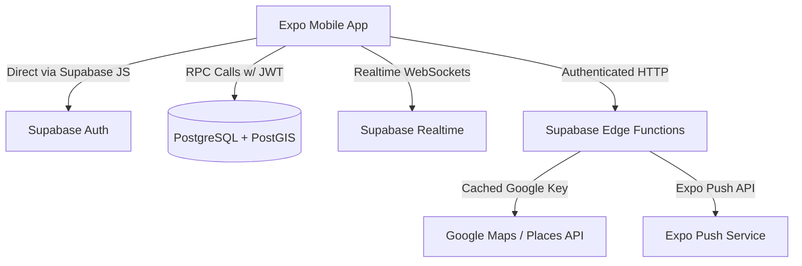

# RideHive Architecture

## 1. Overview
RideHive is a campus-focused ride-pooling mobile application built for students at BML Munjal University (Gurugram). The app enables students to create, discover, and join cab pools for trips between campus and key transit hubs / city hotspots (airports, railway stations, metro stations, malls).

## 2. Core Architectural Principles
- **Host-Centric Cab Model**: The pool creator (host) books external cabs (Uber, Ola, Rapido). RideHive manages group formation, seat inventory, and post-ride fare splitting.
- **Liquidity-First Design**: Unified SQL matching function (`search_pools`) incorporating spatial tolerance (origin/destination radius + route corridor matching via PostGIS `ST_DWithin`), temporal overlap, and proactive ride alerts.
- **Strict Domain Boundary**: Access restricted to `@bmu.edu.in` accounts enforced across 3 distinct layers (client validation, auth hook/trigger, and database RLS).
- **Concurrency-Safe State**: All seat allocations, membership changes, and pool lifecycle transitions execute via `SECURITY DEFINER` Postgres RPCs using row-level locking (`SELECT ... FOR UPDATE`).
- **Separation of Concerns**: Edge functions proxy external Google Maps/Places APIs; server-side secrets never touch the mobile client.

---

## 3. Technology Stack

### Mobile Frontend (`app/`)
- **Framework**: React Native with Expo SDK 52+ (EAS development builds).
- **Language**: TypeScript (strict mode enabled).
- **Routing**: Expo Router (file-based navigation with tab and modal layouts).
- **Server State**: TanStack Query (React Query) with cached invalidation on Supabase Realtime events.
- **Client State**: Zustand for lightweight UI/session state.
- **Forms & Validation**: React Hook Form with Zod schemas.
- **List Virtualization**: Shopify FlashList for performance.
- **UI & Design System**: Custom restrained design system inspired by Uber Rider (strict light mode, no gradients, no emojis, 4pt spacing, Inter typography).
- **Maps**: `react-native-maps` with Google provider using a muted light map style.
- **Storage & Security**: `expo-secure-store` for auth sessions, `expo-notifications` for push.

### Backend Infrastructure (`supabase/`)
- **Database**: Postgres 15+ with PostGIS extension.
- **Authentication**: Supabase Auth (Email OTP restricted to `@bmu.edu.in`).
- **Realtime**: Postgres replication for pool chat, member updates, and settlement changes.
- **Edge Functions**: Deno runtime proxying Google Places Autocomplete, Place Details, and Directions/Routes APIs.
- **Scheduled Tasks**: `pg_cron` for pool expiration and departure reminders.
- **Storage**: Supabase Storage for user avatars.

---

## 4. Directory Structure

```
ridehive/
├── app/                          # Expo React Native mobile project
│   ├── app/                      # Expo Router file-based routes
│   │   ├── _layout.tsx           # Root provider layout (QueryClient, Auth, Theme)
│   │   ├── (auth)/               # Auth group: sign-in, otp-verify, onboarding
│   │   ├── (tabs)/               # Main app tabs: home, rides, inbox, account
│   │   ├── modals/               # Full-screen modals: search, create-pool
│   │   └── pool/[id].tsx         # Dynamic pool details screen
│   ├── src/
│   │   ├── components/ui/        # Reusable design system primitives
│   │   ├── features/             # Feature-sliced modules (auth, pools, search, chat, fare, alerts)
│   │   ├── lib/                  # Supabase client, query client, formatters, config
│   │   ├── theme/                # Design tokens (colors, typography, spacing, radii)
│   │   └── types/                # Database generated types and shared interfaces
│   ├── assets/                   # App icons, splash screens, fonts
│   ├── package.json
│   └── tsconfig.json
├── supabase/
│   ├── migrations/               # Immutable database migrations (PostGIS, schema, RLS, RPCs)
│   ├── functions/                # Deno Edge Functions (places-autocomplete, place-details, route, send-push)
│   ├── tests/                    # pgTAP SQL & RLS tests
│   └── seed.sql                  # Curated Delhi-NCR / Gurugram locations and dev data
├── docs/
│   ├── ARCHITECTURE.md           # System blueprint and technical choices
│   ├── DECISIONS.md              # ADR log for assumptions and choices
│   └── PROGRESS.md               # Phase milestone tracker
├── .github/
│   └── workflows/ci.yml          # GitHub Actions CI for lint, typecheck, tests
├── .env.example                  # Environment variable template
└── README.md                     # Setup, architecture, and developer onboarding
```

---

## 5. Data Flow & Security Model



### Security & Privacy
1. **Row-Level Security (RLS)**: Enforced with default-deny on every table.
2. **Private User Profiles (`profile_private`)**: Phone and UPI IDs are readable only by verified co-members of an active pool via `get_pool_member_contacts`.
3. **Atomic Concurrency**: `join_pool` acquires an exclusive row lock on the target pool, ensuring total confirmed members never exceed `total_seats`.
4. **Isolated Secrets**: Google Maps server API keys remain within Supabase Edge Functions secrets; mobile clients only receive public restricted SDK keys.
